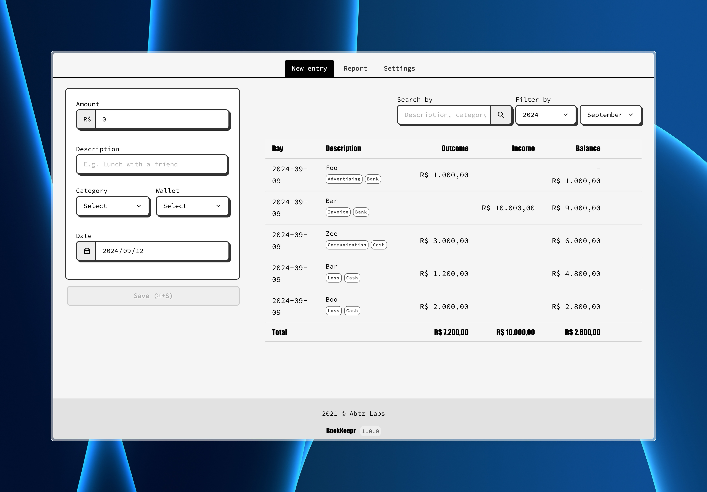

# BookKeepr

by [Rogerio Taques](https://x.com/rogeriotaques).

BookKeepr - _/ˈbo͝o(k)ˌkēpər/_ - is a bookkeeping web app for small businesses and self-employed professionals in Japan. Designed to be simple and easy, it helps us keep track of incomes and expenses, therefore, making it easier to fill out the tax return at the end of each financial cycle. 100% free and open-source, under [MIT](LICENSE) license.



Supports both `single-entry` and `double-entry` methods.

## What is bookkeeping?

It is the recording of financial transactions, and is part of the process of accounting in business and other organizations. It involves preparing source documents for all transactions, operations, and other events of a business.

Transactions include purchases, sales, receipts and payments by an individual person or an organization/corporation. There are several standard methods of bookkeeping, including the single-entry and double-entry bookkeeping systems.

While these may be viewed as "real" bookkeeping, any process for recording financial transactions is a bookkeeping process.

Source: [Wikipedia](https://en.wikipedia.org/wiki/Bookkeeping).

## Get started

### Running locally (development)

Once this repository is cloned, open a terminal window and go to the project folder.

This project uses [`just`](https://github.com/casey/just#installation) as task runner. Run `just` (or `just --list`) to see all recipes.

#### Install dependencies:

```sh
just install
```

#### Run the backend (api) and frontend (app) together:

```sh
just start
```

Or run them separately:

```sh
just start-backend   # http://localhost:8083
just start-frontend  # http://localhost:5173
```

Next, open your preferred browser and visit to `http://localhost:5173` and happy coding 🤘

#### Other recipes:

```sh
just build        # build the frontend for production
just test         # run frontend and backend tests
just test-frontend
just test-backend
```

Without `just`, the same commands work with `npm`:

```sh
cd backend && npm install && npm start
cd frontend && npm install && npm start

# Both from the repository root
npm start

# Tests
cd frontend && npm test
cd backend && npm test
```

### Running the Docker image locally

First, build the image:

```sh
just docker-build --platform linux/amd64
```

> [!WARNING]
> Note: Especially if you're building on a different host platform (e.g. Mac M1), you may need to use the `--platform` flag to specify the correct `target` platform.

> [!NOTE]
> The image installs dependencies with `npm ci`. It pins npm 11.17.0 because the committed `package-lock.json` files were generated with npm 11.

Then, run the image:

```sh
just docker-run
```

> [!NOTE]
> By running the docker as above, all the data will be stored in the `./tmp-data` folder in your local machine.

To stop and remove the container:

```sh
just docker-stop
```

Without `just`, the equivalent Docker commands are:

```sh
docker build --platform linux/amd64 -t abtzco/bookkeepr:latest .
docker run --rm --name bookkeepr -p 8090:8083 -v "$PWD/tmp-data:/bookkeepr/data" abtzco/bookkeepr:latest
docker rm -f bookkeepr
```

### Running the Docker image in `PRODUCTION `

BookKeeper is ready to be deployed so you can use it on the cloud.

For that, you need to spare a server where you can deploy and run docker containers. These steps assume your server has Docker installed.

Once you have SSHed into the server, run the following command to download the image:

```sh
docker pull abtzco/bookkeepr:latest
```

If you already have an old version of BookKeepr docker running, remove the existing container with the command below. If not, skip this step.

```sh
docker rm -f bookkeepr
```

Then, run the image:

```sh
docker run -d --restart always --name bookkeepr -p 80:8083 -v /home/<USER>/bookkeepr/data:/bookkeepr/data abtzco/bookkeepr:latest
```

> [!NOTE]
> If needed, adjust the host port number accordingly. By running the docker with the above command, all the data will be stored in your server's `/home/<USER>/bookkeepr/data` folder.

#### Troubleshooting

If you run into problems related to `sqlite3` and `node-gyp` while running `npm install` or `npm start`, try to downgrade `sqlite` to `^5.0.0` and install `node-gyp` globally with:

```sh
npm install -g node-gyp
```

### Tech stack

- Node 20.17+
- npm (lockfile v3)
- [`just`](https://github.com/casey/just) (task runner)
- Vue 3.4+
- SQLite
- Docker image `node:22-alpine3.19`

## Questions?

Have a question or need some help? <br>
Drop me a line on [Twitter](https://twitter.com/rogeriotaques).

## Bug reports and contributions

Please report bugs [here](https://github.com/rogeriotaques/bookkeepr/issues). 🙇‍♂️

Also, contributions are very welcome as `pull requests.` If you find a bug, want to improve, or add a new feature, please open a PR. 🙏
